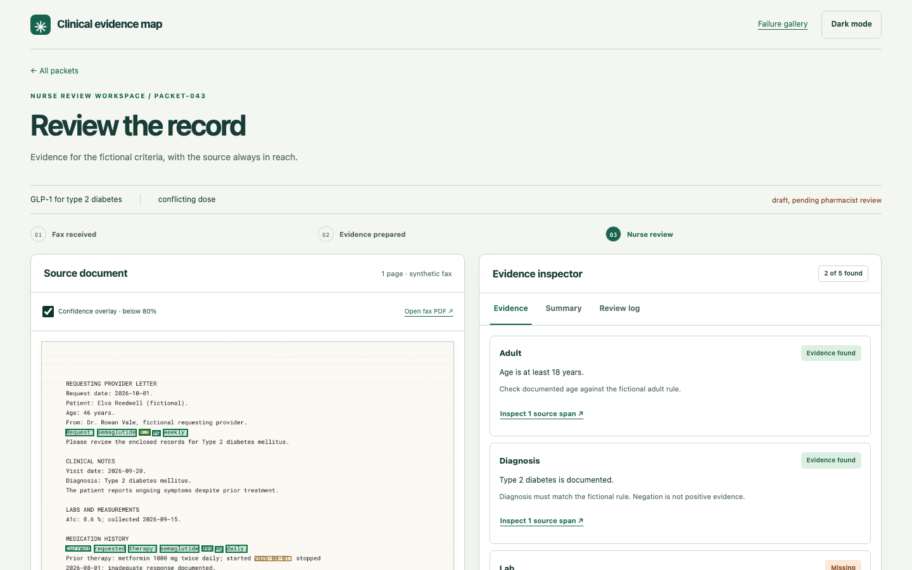

# Clinical evidence map

**The hard question:** when a nurse opens a faxed prior-authorization packet, does every finding the tool shows point to the exact words on the page, and does it say "review this" instead of guessing when it cannot tell?

**Short answer, on 50 synthetic packets:** every finding is traceable. All 728 extracted values, evidence links and summary citations reproduce their quote from the redacted page. The tool never marked a criterion as met where the draft labels say it is not. It does have a real failure mode. It showed "Required documentation not found" for 38 of 240 criteria that the draft labels show as documented or needing review: 25 in the five skewed scans and 13 where OCR read "A1c" as "Alc".

**Synthetic only. Every label is draft, pending pharmacist review.** No label has been reviewed yet, and no second independent reviewer has checked them. This is an inspectable working prototype. It makes no coverage decision and claims no clinical validation or time saving.



## What it does

A utilization-management nurse opens a faxed packet. The tool reads the image with OCR, removes names and dates with a privacy gate, extracts diagnoses, medications, doses, labs and prior therapy, and shows which source statements support each of five fictional criteria. Every finding links back to its words on the page. The nurse accepts, corrects or flags each one, and every action goes into an append-only, hash-chained log. The nurse makes the decision.

## How we test it

| Question | Test set | Result | Limit |
| --- | --- | --- | --- |
| Is every finding tied to its source? | 50 synthetic faxed packets, OCR output | 728 / 728 spans reproduce their quote | Checks the quote, not whether the quote is medically right |
| Does it say "met" only when it should? | 250 criterion statuses vs draft labels | 0 marked met against the draft. 124 / 250 statuses match exactly | Draft labels, pending pharmacist review |
| Does it miss documentation that is there? | Same 250 statuses | 38 / 240 documented or needs-review criteria shown as not found | Skew and one OCR misread cause all 38 |
| Does it pull out the clinical facts? | 600 clinical draft labels | Precision 356 / 362, recall 356 / 600 | Dates are removed by the privacy gate, so date labels count as misses |
| Can the OCR read the page? | 50 rendered fax images | 1.21% character error rate (418 / 34599) | Simulated scans and a handwriting-like font, not real faxes |
| Does the verifier catch unsupported summary sentences? | 150 injected bad claims | 150 / 150 caught | Exact-quote rule, so it catches these by construction. Not a hallucination benchmark |

All 50 packets are development data. There is no separate holdout, no do-nothing or do-everything control and no confidence interval yet. Full tables, slices by scan quality and scoring rules are in [the evaluation](docs/EVALUATION.md).

## Follow one packet

Open `packet-043`, whose request and medication list disagree about the dose. Select the dose criterion to highlight both source statements. Turn on OCR confidence, inspect the cited summary, and record a correction. Reload to inspect the append-only review event. The [review GIF](docs/media/review-flow.gif) shows that scripted path. This packet also shows the main failure: its A1c line was read as "Alc", so the lab criterion shows as not found.

The queue holds 50 packets across ten quality groups and three fictional drug-class criteria sets. The failure gallery lists every mismatch against the draft reference for every packet, including missing sections, stale and conflicting dates, ambiguous trials, dose conflicts, skew and simulated handwriting.

## Limits

This is a single-user prototype on synthetic templates. It does not prove clinical accuracy, safety, nurse time saved or performance on real faxes. The privacy gate removes all dates, so time-window and trial-length criteria always need review even when OCR reads them correctly. The gate also replaces some clinical words with `[name]`, for example "Established" in "records for Established atherosclerotic cardiovascular disease". That over-redaction is not yet measured. Exact quotation checks catch fabricated citations but cannot tell whether a quoted statement is true. The packets reuse English templates, so scores may look better than they would on varied documents. The brief's extraction and criterion targets are not met. No real public documents are tested yet.

The app has no authentication, multi-user isolation, validated de-identification or externally anchored audit storage. Raw images and OCR contain fictional names. The review log records annotations and does not change gold labels or confer pharmacist approval. Do not enter real data. See the full [limits and retention notes](docs/HOW-BUILT.md#limits).

Kevin designed the workflow and the synthetic label set and will review the draft labels as the pharmacist on the project. AI coding tools assisted with implementation. See [how it was built](docs/HOW-BUILT.md).

## Run locally

Requires Node 22 or newer and a free English OCR model download on first rebuild. No API key, account or paid service is used. The redaction library is installed from a pinned commit of its public repository.

```sh
npm ci
npm run eval -- --check
npm start
```

Open `http://127.0.0.1:4178`. The checked-in synthetic fax PDFs, images and OCR outputs let you inspect and rescore the demonstration immediately. `npm run eval -- --rebuild` regenerates all 50 images, image-only PDFs and OCR outputs with local Tesseract. It can take several minutes. `npm run eval` recomputes derived outputs and metrics, generating missing or stale OCR artifacts when necessary.

A second consumer, a care-management summary, reuses the same redaction and extraction modules:

```sh
npm run summary -- eval/packets/packet-001.md
```

## What is reusable

| Service | Input | Output |
| --- | --- | --- |
| OCR | Synthetic rendered image | Text, per-word confidence, boxes and review routing |
| Redact | Text | Redacted text or a blocked result, using pii-redaction-gate |
| Extract | Redacted text | Medications, doses, diagnoses, measurements and prior therapies with exact source spans |
| Link evidence | Entities and fictional criteria ID | Found, missing or needs-review status with supporting spans |
| Verify | Summary sentences and citations | Exact-citation support or a review flag for each sentence |
| Audit | Review action, target and note | Append-only, hash-chained local event |

[Typed contracts](services/contracts.ts), [workflow and build decisions](docs/HOW-BUILT.md), [terminology sources](docs/TERMINOLOGY.md) and [evaluation method and results](docs/EVALUATION.md) make the boundaries inspectable.

## Verify the build

```sh
npx playwright install chromium
npm run gate
```

The gate typechecks the services, tests all six contracts and provenance, reproduces saved metrics, and exercises review actions, persistence, keyboard access, overflow and WCAG AA checks at 1440×900, 430×932 and 390×844 in light and dark. [Verification evidence](docs/VERIFICATION.md) records the commands and exit codes. `npm run media` records the GIF in a visible local browser.
