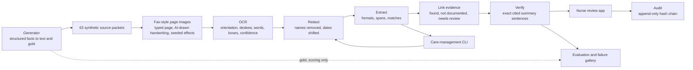

# How this was built

Kevin designed the workflow, the synthetic data and the label set, and adjudicates the draft labels as a pharmacist. On 2 November 2026 he reviewed 21 criterion labels. 13 of them still apply word for word and are marked reviewed. The other 8, on diagnosis and prior therapy, changed after his notes and wait for his second look. Every other label is a draft. No second independent reviewer has checked them. AI coding tools assisted with implementation, test authoring, evaluation plumbing and documentation. An image model drew the handwriting images. There has been no observed nurse study or clinical validation.

The user is a utilization-management nurse. The decision is whether a synthetic packet contains documentation supporting each fictional criterion. Missing evidence leads to review and a request for documentation. The tool never approves or denies coverage.

## Services and workflow

Each service has a typed contract in `services/contracts.ts`, its implementation in its own directory and a dedicated test file. The evaluator alone reads gold. OCR and the pipeline never read labels, scenarios or group names.

## The evaluation set

`scripts/generate.ts` builds every packet from structured facts and writes the gold labels by applying the fictional rules to those facts. The generator, the extraction rules and the link rules were written by the same people at the same time. On the source text the pipeline reproduces every draft label, which shows the rules cover the generator's phrasings and nothing more. The measured errors come from the page images. See [the generator spec](../eval/GENERATOR-SPEC.md).

Because the rules and the generator grew together, results on these 63 packets are development results. A held-out set of 24 packets, written by Codex from a written spec alone with no access to the generator, the pipeline or any development packet, was frozen by sha256 and committed before the pipeline first ran on it. It ran once, on 2 November 2026, and scored 37 of 120. From 3 November the reading rules are being changed after seeing it, so it is development data from then on. Its blind score stays in `eval/holdout/results/first-score.json`, and any later score on it is reported as a development result. A second held-out set, written blind by two other model families and frozen the same way, ran once on 3 November 2026 with the stage D rules and scored 85 of 120, against 49 for always answering "found". `scripts/evaluate.ts` scores a held-out set only while its files match the sha256 in its `FREEZE.json`. Its first run needs the freeze, its files and the tracked code committed, claims the set with an exclusive create, reads every page again, and writes the first score once with the sha256 of every frozen and OCR file it used. Every later run must match that record and is saved as a development result. These checks catch mistakes and silent changes here. They cannot show that nobody ran the pipeline on a set some other way before its first run. See [the evaluation](EVALUATION.md).

Labels are balanced so that answering "evidence found" every time scores about half, not 88% as before. Gaps and near misses are common. Dates, drug names, doses, frequencies, layouts and spellings vary, and every variation is tagged so results break out by it.

## Pages

Pages are typed in one of three bundled fonts, Roboto Mono, Liberation Sans or DejaVu Sans, so the slashed zero in Roboto Mono does not decide every number OCR reads. They are then changed by seeded effects: speckles, faint streaks, shifted scan-line bands, smudges, low contrast, a 7-degree rotation, or a turn of 90, 180 or 270 degrees. Two groups add AI-drawn handwriting from Codex's built-in image generation: five medication-history blocks and ten short notes cut from two sheets, composited where the typed text would be, with drawn circles, arrows and underlines on the mixed pages. These are fax-style page images. None was printed, faxed or scanned, and the handwriting is AI-drawn, not a real person's. Gold text follows what each drawn image shows. Provenance for every image is in `eval/handwriting/handwriting.json`.

A packet can run to several pages. A line holding only `<<page>>` in the packet text starts a new page and is never drawn or quoted. `services/ocr/packet.ts` draws each page with the same one-page renderer, page 1 under the packet's own seed and later pages under their own, and binds them into one PDF. OCR reads each page on its own, and `services/ocr/pages.ts` joins the page texts in order. Every page ends on a line break, every word keeps its page number, and every offset points into the joined text, so the pipeline's quotes reproduce from it as they do on one page. Gold offsets in a packet of several pages are counted in the packet text as written, marker lines included, and scoring compares quote text, so both line up. The one-page renderer in `services/ocr/index.ts` did not change and a one-page packet takes the same path as before. A test finds identical pixels for three one-page packets, and the stored OCR and fingerprints of every one-page packet were not rebuilt.

OCR uses the free English Tesseract LSTM worker locally. Before reading a page it makes two quick half-size reads to choose between upright and upside down, or between the two sideways turns for a landscape page. It then estimates small skew from row profiles and straightens the page. The straightened copy is saved next to the original, and word boxes refer to it.

Before the reading rules see the text, `services/ocr/coverage.ts` builds a coverage record from the OCR output alone: pages received, page counters read from the first and last lines of each page in forms such as "P.002/003", "Page 2 of 3", "pg 2/3" and "2 of 3", the page numbers the counters say are missing, whether each page's turn was chosen by a clear margin, word confidence per page, and the runs of lines with a word below the review threshold. It travels into the pipeline with the OCR text, and the reading rules use it to name a missing, unreadable or out-of-order page instead of answering "not documented". The evaluation also compares OCR with the source text to count source lines OCR did not give back. That comparison needs the source text, so it never reaches the pipeline.

## Privacy step

The pinned `pii-redaction-gate` library at `63ac3abc48094e86f6883f99c1586b45bf6ebd3f` still removes names. Three changes sit around it in `services/redact`:

- A clinical vocabulary list goes to the library's existing safe-word option, so condition, drug and form words such as "Type", "Moderate", "Established" and "Lipitor" are no longer hidden as `[name]`. At 2b4d487 the condition after "records for" was hidden in 48 of 50 letters as read by OCR. Every list entry is a clinical word that cannot name a person.
- The library's two-word name rule could match across a line break and join two lines with a space. An invisible separator before each break keeps it on one line. Name pairs split across a break are then checked with the same library rule and removed.
- Every date the step can read becomes a token such as `[date-c]`, and a separate channel carries its readings shifted by a per-packet number of days. Intervals survive, so the 90-day and 180-day rules can be checked, and no original date reaches extraction. A date that could be month first or day first keeps both shifted readings. Dates the step cannot read are left to the library, which removes them. Month and day without a year are removed.

This is not a de-identification service and makes no certification claim. During evaluation the shift comes from the packet ID so runs reproduce, which means it is not secret. A deployment would need a random shift kept apart from the text, plus its own privacy review. The care-management CLI does not shift and still removes dates.

## Extraction and rules

Extraction first builds a model of the page from the redacted text: headings, key-value fields, tables bound to their headers, checkboxes with their state, question and answer pairs, SOAP parts, prose, wrapped values and page breaks. It knows label synonyms, blank fields, many date formats, generic and brand drug names, abbreviations, dose and frequency codes, titrations, sigs with tablet counts and condition synonyms. Each condition mention carries who it is about, negation before or after it, uncertainty and the role of its section. Prior therapy is read as drug-linked courses, so an outcome belongs to the drug it was written about. A word one edit from a single known drug or condition name is accepted as a spelling variant with lower confidence. A name that is itself a known look-alike, such as Trexan for Trexall, is never accepted as the drug it resembles. Every entity keeps the exact line it came from. Lines that mention a criterion but could not be read, low-confidence lines and pages that did not arrive are kept in a ledger, and "not documented" is answered only when nothing in it blocks that claim. See [the stage D reader](STAGE-D-READER.md).

A day above 12 anywhere on the page settles numeric date order for the page. Otherwise a fax-style received date can rule out a reading that would put any date after it. If neither works, the date keeps both readings, and the link step evaluates each rule under both. When the answers differ it reports needs review and says why. It never guesses a date order.

Rules and exact quotations remain the baseline. The verifier accepts only an exact statement with a valid citation. It does not understand medical entailment.

## Review and retention

Accept, correct and flag record an event with a target, note, timestamp and previous-event hash. Corrections are annotations, not edits to gold or silent changes to extracted facts. A review event never marks pharmacist labels reviewed.

The local server binds only to loopback and rejects foreign browser origins. It never loads an operator people map, sends documents to a model or treats document text as instructions. Page images and raw OCR contain only synthetic names. Default review events live in ignored `.runtime/reviews.jsonl`. Generated pages and OCR live in `eval/artifacts`, results in `eval/results`, both checked in for inspection and repeatable scoring. No real data should be entered.

## LIMITS

- The 63 development packets come from one generator with shared templates. The first held-out set is small, 24 packets from one other model, without handwriting or reviewed labels, and from 3 November 2026 it is development data. No clinical performance claim is supported.
- The extraction rules were written alongside the generator. Phrasings outside these templates and layouts with columns or tables are untested. Packets of several pages are tested only on two fixtures built from one development packet. A page missing from a packet without page counters goes unnoticed.
- AI-drawn handwriting is not a person's handwriting, and seeded effects are not real fax damage. Results on real faxes are unknown.
- Confidence is the OCR engine's estimate, not calibrated clinical certainty.
- Exact quotation checks cannot establish correctness, completeness or safety. A faithfully quoted source may itself be wrong.
- The log is append-only through this single-process API. It is not a signed or externally anchored audit system. There is no authentication, multi-user isolation, retention automation or cross-process locking.
- This local prototype is not a de-identification service, medical device or production clinical platform.
- No paired nurse study was run. Override rate and time saved remain unmeasured.
