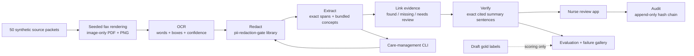

# How this was built

Kevin designed the workflow and the synthetic data and label set. Kevin will evaluate and adjudicate the draft labels as a pharmacist. Every label remains `reviewed=false` until he does. A second independent reviewer has not been done. AI coding tools assisted with implementation, test authoring, evaluation plumbing and documentation. There has been no observed nurse study or clinical validation.

The user is a utilization-management nurse. The decision is whether a synthetic packet contains documentation supporting each fictional criterion. Missing evidence leads to review and a request for documentation. The tool never approves or denies coverage.

## Services and workflow

Each service has a typed contract in `services/contracts.ts`, its implementation in its own directory and a dedicated test file. Services are modules within the existing local application runtime, with no daemon, queue or new authority. The evaluator alone reads gold. The OCR and pipeline services do not read labels or quality-group expectations.

## Why these choices

Rules and exact quotations are the baseline. The source set has short, repeated templates and three fixed fictional criteria sets. A generative model would add expense and unverifiable claims without evidence of a benefit here. The verifier deliberately accepts only an exact statement with a valid citation. It does not understand medical entailment. A 100% mutation catch rate is therefore a software contract check, not a clinical reasoning score.

OCR uses the free English Tesseract LSTM worker locally. Seeded speckles, light streaks, seven-degree skew and a bundled handwriting-like font create controlled input variation. Glyph outlines from the bundled fonts avoid a system font substitution. These are simulated scans, not a validated sample of actual faxes. Missing-page conditions omit source sections within one rendered page. Medication history uses Kalam in the handwriting group, not real handwriting.

The current `main` version of `pii-redaction-gate` is pinned at `63ac3abc48094e86f6883f99c1586b45bf6ebd3f`. Its identifiers profile removes all dates. We keep that behavior. Extraction can preserve a measurement while its collection date is absent. Timing and treatment-duration rules then require review. This is a visible build-versus-reuse tradeoff that must be resolved before usefulness can be claimed. A future reviewed structured date channel would need its own privacy contract.

Entities carry exact, end-exclusive Unicode code point spans into redacted OCR text. Original gold offsets refer to the source Markdown body, so comparing their integer offsets with OCR offsets would be invalid. Evaluation reports value F1 and exact supporting quote matches separately. Every predicted span is checked against its own document. Image highlights map surviving OCR words to the redacted text. Repeated tokens and OCR errors can make that mapping imperfect, so the exact text quote is authoritative.

The terminology subset contains six ingredient concepts and two diagnosis mappings. Ingredient normalization is not dose or formulation validation. Broad atherosclerotic disease wording stays unnormalized because it does not justify a specific ICD-10-CM code. Sources and retrieval date are in [TERMINOLOGY.md](TERMINOLOGY.md).

## Review and retention

Accept, correct and flag record an event with a target, note, timestamp and previous-event hash. Corrections are annotations, not edits to gold or silent changes to extracted facts. They survive reloads. A review event never marks pharmacist labels reviewed. The queue displays the latest action separately from label review status.

The local server binds only to loopback. Review writes reject foreign browser origins. It never loads an operator people map, sends documents to a model or treats document text as instructions. The checked-in images and original OCR contain only synthetic names. Raw OCR is kept locally for evaluation and visual inspection, with redacted OCR used for extraction.

Default review events live in ignored `.runtime/reviews.jsonl`. Delete that file to reset the local exercise after stopping the server. Generated OCR and fax assets live in `eval/artifacts`, derived results in `eval/results`. Both are checked in for inspection and repeatable scoring. No real data should be entered.

## LIMITS

- All 50 packets are development templates. No held-out evaluation or clinical performance claim is supported. Draft gold is unchanged and awaits pharmacist review.
- Date redaction reduces recall and leaves otherwise documented criteria unresolved. The current implementation misses the brief's extraction and criterion targets.
- Rules support the declared English templates. Negation, formatting drift, repeated sections, conflicts outside the templates and unseen medications need more work. Confidence is the OCR engine's estimate, not calibrated clinical certainty.
- Exact quotation verification cannot establish correctness, completeness or safety. A faithfully quoted source may itself be wrong.
- The log is append-only through this single-process API and detects changed records within a retained chain. It is not a signed or externally anchored audit system. File owners can truncate or replace it. There is no authentication, multi-user isolation, retention automation or cross-process locking.
- Scan assets and raw OCR are synthetic and intentionally inspectable. This local prototype is not a de-identification service, medical device or production clinical platform.
- No paired nurse study was run. Override rate and time saved remain unmeasured. GIF and browser actions are scripted demonstrations. There is no hosted comparison because external transfer and paid inference were outside scope.
